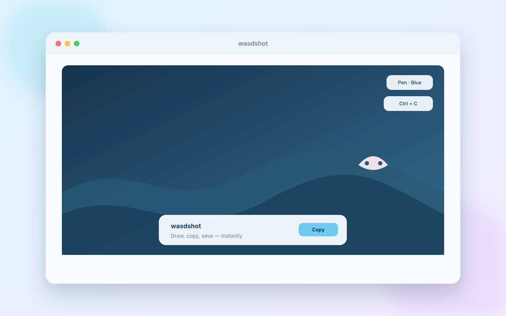
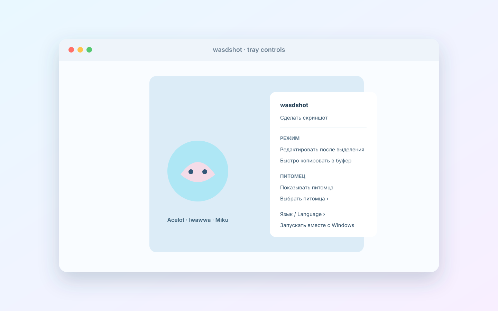

# wasdshot

  

  

Компактный Windows-скриншотер с полноэкранным оверлеем. Панель действий собрана из реальных компонентов shadcn/ui (Base UI): Card, Button, ToggleGroup, Badge, Separator и Tooltip. Захват экрана, системный хоткей, буфер обмена и сохранение PNG работают в нативном C#-хосте через WebView2.

## Запуск

Скачайте и запустите `wasdshot-setup-v2.exe`. Установщик не требует прав администратора: приложение размещается в `%LocalAppData%\Programs\wasdshot`, добавляется в меню «Пуск» и в список установленных приложений Windows. Для удаления используйте «Параметры → Приложения → wasdshot». Портативная версия находится в `release-v2/` и архиве `wasdshot-v2.zip`; не перемещайте один `.exe` отдельно от DLL, папок `ui/dist` и `assets`. Требуются Windows x64, .NET Framework 4.8 и Microsoft Edge WebView2 Runtime.

При запуске приложение остаётся в трее и показывает системное уведомление. Интерфейс загружается при первом снимке. Нажмите `Win + Shift + S` и выделите область мышью. Затем доступны копирование, сохранение PNG, перо, прямоугольник, эллипс, линия, стрелка, четыре цвета, отмена и новое выделение. `Esc` закрывает оверлей даже до готовности WebView2 или до выделения области; приложение остаётся в трее. Меню трея автоматически следует светлой или тёмной теме Windows.

После завершения выделения перо включается автоматически. В трее выберите режим: «Редактировать после выделения» открывает оверлей с инструментами, а «Быстро копировать в буфер обмена» сразу кладёт выделенную область с питомцем и пометками в буфер обмена и закрывает оверлей. Там же доступны «Язык / Language» (русский или English), выбор питомца и переключатель «Запускать вместе с Windows».

wasdshot проверяет последний GitHub Release при запуске и по команде «Проверить обновления» в трее. Если версия новее, приложение предлагает скачать и запустить установщик. Для следующего релиза создайте GitHub Release с тегом вида `v3.0.0` и прикрепите к нему `wasdshot-setup-v3.exe`.

Приложение пытается перехватить `Win + Shift + S` до запуска Windows Snipping Tool при помощи низкоуровневого клавиатурного перехватчика. Это не меняет настройки Windows и не гарантируется на защищённом рабочем столе либо если система/другое ПО забирает сочетание раньше. Перехват можно отключить в трее. Резервный хоткей — `Ctrl + Shift + S`, а если он занят, `Ctrl + Alt + S`. Актуальный вариант отображается в подсказке оверлея и трея. Двойной щелчок по иконке трея тоже открывает захват.

`Enter` и `Ctrl + C` копируют выделение вместе с пометками и сразу закрывают оверлей; `Ctrl + S` сохраняет PNG; `Ctrl + Z` отменяет последнюю пометку. После закрытия снимка окно и WebView2 полностью уничтожаются, а новый чистый оверлей сразу прогревается невидимо в фоне. Поэтому предыдущий кадр не может мигнуть, но следующий захват открывается без повторного холодного запуска браузерного движка. Пока актуальный кадр декодируется, нативное окно показывает только его собственное превью.

Питомец по умолчанию выключен. Включайте его через «Показывать питомца», а самого питомца выбирайте в подменю «Выбрать питомца» в трее. Доступны Acelot, Iwawwa и Hatsune Miku; выбор сохраняется между захватами. Питомца можно перетаскивать мышью внутри области; при копировании и сохранении он накладывается на снимок после пометок. Положение устанавливается заново для каждого выделения. Голубой, красный и зелёный варианты интерфейса по-прежнему меняют только цветовую тему и иконку трея.

Тема интерфейса и значок ацелота в трее выбираются вместе: голубая, красная или зелёная. Переключатель есть до выделения области, на панели действий и в контекстном меню трея. Выбор сохраняется между запусками.

## Исходники и сборка

`Ctrl + C` и `Ctrl + Z` перехватываются нативным хостом независимо от фокуса WebView2. Буфер обмена записывается с повторными попытками; после успешного копирования оверлей закрывается. Одно нажатие `Ctrl + Z` отменяет ровно одну последнюю пометку.

`Program.cs` — нативный хост. `Installer.cs` — установщик и деинсталлятор. `ui/` — React/shadcn интерфейс. `assets/` — три иконки трея и прозрачные изображения питомцев. Pet встраивается в интерфейс как `data:`-картинка, чтобы его можно было экспортировать вместе со снимком. Закрытие оверлея уничтожает его WebView2 и всё состояние прошлого захвата; следующий экземпляр прогревается заранее и использует общий уже запущенный WebView2 environment. Первый нативный кадр уже затемнён, а область выделения обновляется один раз за кадр через `requestAnimationFrame` и рисуется одним слоем. Повторное `Win + Shift + S` при открытом оверлее закрывает его как аварийный выход вместе с `Esc`. `sdk/` — локальные библиотеки Microsoft WebView2 для сборки. Запустите `Build.ps1` из PowerShell, если хотите пересобрать проект и установщик. Для пересборки UI необходимы зависимости из `ui/node_modules` (или выполните `pnpm install`). Готовая версия лежит в `release-v2/`, установщик — `wasdshot-setup-v2.exe`.

Если в трее ещё запущена старая версия wasdshot, закройте её через пункт «Выход», иначе она может занять `Ctrl + Shift + S`.

